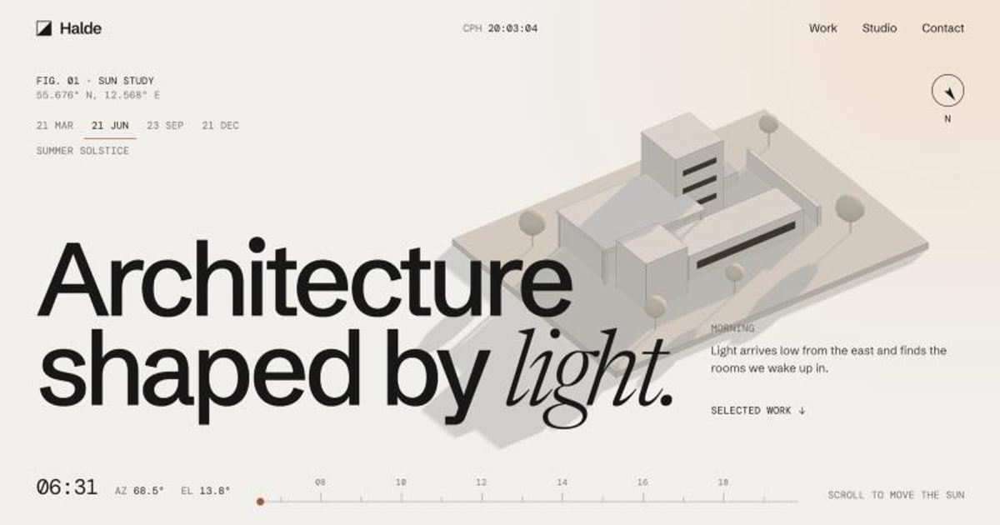

# Halde Architects

Concept site for a fictional architecture studio in Copenhagen. The hero is a live sun study: a white Three.js maquette lit by the real sun over the city, with a clock that scrolls from sunrise to sunset on four dates of the year.

**[View the live site](https://aledev11.github.io/halde-architects/)**

[](https://aledev11.github.io/halde-architects/)

All projects, people and quotes are invented. Press **G** on any page to see the 12-column grid.

## How the sun study works

- **Real solar geometry.** [`src/scripts/solar.ts`](src/scripts/solar.ts) implements [NOAA's solar equations](https://gml.noaa.gov/grad/solcalc/solareqns.PDF) with no dependencies. On 21 June it gives a sunrise of 04:24, a sunset of 21:57 and a peak elevation of 57.8°; on 21 December, 08:36, 15:38 and 10.9°.
- **Rendered on the server, then taken over.** The same functions run at build time, so the time and angles are correct before any JavaScript loads. The 3D scene loads after the headline has painted.
- **Scroll maps to the day.** Scroll position is a 0 to 1 progress value, turned into a clock time inside that date's daylight. Changing the date eases between the two sun paths and rebuilds the hour track.
- **Reveals that cannot strand content.** Anything at or above the trigger line plays, so an anchor link, the End key or a restored scroll position never leaves a blank section behind. If the scripts fail to load, a timeout shows the page without its animations.
- **Reloads that hold still.** An inline script restores the scroll position before the first paint and marks what is already on screen, so a reload or the back button lands in place with nothing to re-animate. The intro plays once per session.
- **A scrollbar drawn like a plan scale.** For mouse users, a thin bar with a tick at each section replaces the native one. It blends against light and dark sections, and it can be dragged or clicked. Touch devices keep the native scrolling.
- **Fallbacks.** Reduced motion gets a static hero at a fixed hour, and browsers without WebGL get a photograph of a real model.

## Error pages

`404`, `403`, `500` and `503` share [`ErrorPage.astro`](src/components/ErrorPage.astro), each with its own drawing. GitHub Pages only serves the 404 automatically; the others are ready for a host that can map status codes to pages.

## Stack

Astro 7, Three.js, anime.js v4, Lenis and hand-written CSS. Deployed to GitHub Pages with GitHub Actions.

## Run it

Requires [pnpm](https://pnpm.io). It uses Node 22.23.4 for this project automatically, through `.npmrc`.

```bash
pnpm install
pnpm dev
pnpm check
pnpm build
```

The site is served under `/halde-architects`, so internal links go through `url()` in `src/utils/url.ts`.

## Credits

Designed and built by [Alejandro Font](https://afont.dev). Code under the [MIT License](LICENSE). Photography from Unsplash under the Unsplash License, listed in [`src/data/credits.ts`](src/data/credits.ts).
